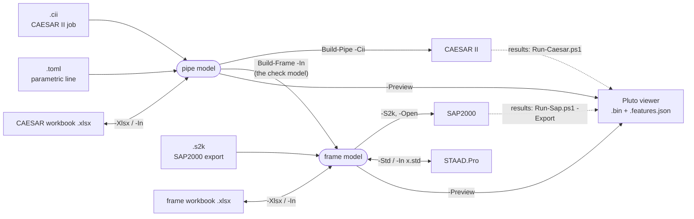

*↑ [[vault/Pluto Home|Home]] › [[vault/arms/Arms map|Arms map]]*

# Pipe and frame workflows: start here

How the pieces on branch `pipestress` fit together, and the commands for each job. Pluto keeps two models:
- **the pipe model**, in CAESAR II's terms ([[vault/format/pipe-model|pipe-model]]);
- **the frame model**, a SAP2000 `.s2k` typed ([[vault/format/frame-model|frame-model]]).

Each has an Excel workbook to edit it in, a runner that builds the files, and a viewer preview. The pipe model also
seeds a frame model: SAP's structural check model of the pipe.



Solid arrows are what the two runners build. Dotted ones bring a program's results to the viewer. Nothing goes from
SAP back to CAESAR; those ways back are listed as later work in
[[vault/decisions/2026-11-12-caesar-to-sap|2026-11-12-caesar-to-sap]]. A `.std` written with `-Std` comes back as a
frame model with `-In <x>.std`, STAAD's edits too. The STAAD post-processing lib's `.anl` reader (`scripts/lib`)
reads it: its parsers now take a `.std`'s input as well ([[vault/format/frame-to-staad|frame-to-staad]]). Its
`.anl` results work (section cuts, design spreadsheets) is otherwise not part of this pipeline; see STAAD in the
[[vault/arms/Arms map|Arms map]].

> [!info]- The runners and what they take
> All run under Windows PowerShell 5.1, need no Python, and end with one `RESULT {json}` line. Below, `...` stands
> for `powershell.exe -NoProfile -NonInteractive -ExecutionPolicy Bypass -File`. Outputs default to sit beside the
> input; an output inside this repo is refused.
>
> | Runner | In | Out | Note |
> |---|---|---|---|
> | `scripts\caesar\Build-Pipe.ps1` | `.cii`, `.toml`, CAESAR workbook `.xlsx`, `.pipe.json` | `-Cii`, `-Xlsx`, `-Json`, `-Preview`, `-Compare <file>`; `-Watch`, `-NewWorkbook [-Seed <.cii>]`, `-Refresh` | [[vault/arms/pipe-workbook\|pipe-workbook]], [[vault/arms/pipe-builder\|pipe-builder]] |
> | `scripts\frame\Build-Frame.ps1` | `.s2k`, frame workbook `.xlsx`, `.frame.json`, a `.std` written with `-Std`; a CAESAR model (`.cii`, `.toml`, `.pipe.json`, CAESAR workbook) seeds the check model | `-S2k [-Open]`, `-Xlsx`, `-Std`, `-Json`, `-Preview`; `-Watch`, `-NewWorkbook`, `-Refresh`; `-AppendixD`; probes `-Probe`, `-ProbeCheck`, `-StdProbe` | [[vault/arms/frame-workbook\|frame-workbook]], [[vault/format/pipe-to-frame\|pipe-to-frame]], [[vault/format/frame-to-staad\|frame-to-staad]] |
> | `scripts\caesar\Run-Caesar.ps1` | `-Neutral <.cii>` `[-Results <CAESAR output .xlsx>]` | `.bin` + `.features.json` with CAESAR's results | [[vault/arms/caesar-to-viewer\|caesar-to-viewer]] |
> | `scripts\sap\Run-Sap.ps1` | a running SAP2000, or `-Open <.s2k\|.sdb>` | `-Run`, `-Results <s2k>`, `-Export <base>` (viewer files) | [[vault/arms/sap-controller\|sap-controller]], [[vault/arms/sap-export-model\|sap-export-model]] |
>
> A workbook written with `-Xlsx` (or `-NewWorkbook`) gets launchers beside it, linked from its Start sheet:
> - CAESAR workbook: `<base> - preview.cmd` (`-Preview -Watch`) and `<base> - cii.cmd` (`-Cii -Preview`);
> - frame workbook: `<base> - preview.cmd`, `<base> - s2k.cmd`, `<base> - open in SAP.cmd` and `<base> - std.cmd`.

> [!info]- Edit an existing CAESAR job, and send it back
> 1. `... scripts\caesar\Build-Pipe.ps1 -In "<project dir>\job.cii" -Xlsx`. The import checks that writing the model
>    back gives the `.cii` byte for byte, and says so.
> 2. Open `job.xlsx` and run its preview launcher. Every save rebuilds the viewer files. In the viewer, pick them
>    with "Choose files" (Chrome / Edge) and tick Auto-reload, so each rebuild shows with the camera kept. The Checks
>    panel and the workbook's cells show CAESAR's own error checks ([[vault/arms/caesar-checks|caesar-checks]]).
> 3. Run the `cii` launcher, or `... Build-Pipe.ps1 -In "<project dir>\job.xlsx" -Out "<project dir>\job_v2" -Cii`.
>    What nothing edited is written as it came; the report lists every edit.
> 4. Import the `.cii` in CAESAR. After CAESAR re-exports it, `-Compare <its .cii>` checks the two by meaning.
>
> ```mermaid
> flowchart LR
>   A["job.cii"] -->|"-Xlsx"| B["job.xlsx"]
>   B -->|"save (-Preview -Watch)"| C["viewer: model, loads, Checks"]
>   B -->|"-Cii"| D["job_v2.cii"]
>   D --> E["CAESAR II"]
>   E -->|"re-export"| F["-Compare"]
> ```

> [!info]- Start a new line
> - **From a template:** `... Build-Pipe.ps1 -NewWorkbook -Out "<project dir>\new_line"`. Add `-Seed <job.cii>` to take
>   a CAESAR job's settings (version, units, options, allowables). Then edit and preview as above.
> - **From a parametric TOML:** runs, bends, branches, components, supports by type, loads
>   ([[vault/arms/pipe-builder|pipe-builder]]; every key in `scripts\caesar\examples\pipe-example.toml`).
>   `... Build-Pipe.ps1 -In "<project dir>\line.toml" -Preview -Watch` while you write it, then `-Cii`. A `.toml`
>   with no output switch writes the `.cii`, plus `<base>.nodes.csv` with the node numbers by position.

> [!info]- Look at CAESAR's results in the viewer
> `... scripts\caesar\Run-Caesar.ps1 -Neutral "<project dir>\job.cii" -Results "<project dir>\job.xlsx" -Out
> "<project dir>\viewer\job"`. The CAESAR output workbook gives per-case displacements, element forces, code stresses
> and restraint loads ([[vault/arms/caesar-to-viewer|caesar-to-viewer]]). Drop the `.bin` and the `.features.json` on
> the viewer together.

> [!info]- The SAP check model of a CAESAR job
> The same pipe, loads and supports as frames, links and loads, for member forces and support reactions. No code
> checks: those stay in CAESAR ([[vault/format/pipe-to-frame|pipe-to-frame]]).
> 1. **Materials.** Give E, Poisson, density and α on the CAESAR workbook's Materials sheet. A `.cii` or a TOML has
>    none, so it takes Pluto's defaults by material class, with a warning.
> 2. **Seed:** `... scripts\frame\Build-Frame.ps1 -In "<project dir>\job.xlsx" -Xlsx -S2k -Preview`. The input can also
>    be `job.cii`, a `.toml` or a `.pipe.json`. Outputs are `job_sap.*`. Anything the check model cannot hold exactly
>    stops it, each item on a `[refuse]` line; fix those in the pipe model and seed again. Add `-AppendixD` for a job
>    CAESAR runs with B31J off.
> 3. **Edit in the frame workbook,** `job_sap.xlsx`: steel, extra supports, cases. New frames and nonlinear cases take
>    the seed's SAP settings. The seed is made once: seeding again starts over from the pipe, and asks before it
>    replaces a workbook with edits (the old one kept as `.bak`).
> 4. **To SAP:** the `open in SAP` launcher, or `-S2k -Open`, imports it on the production machine. Run every case:
>    with nonlinear supports, SUS runs first and each OPE continues from its end state.
>
> ```mermaid
> flowchart TD
>   A["CAESAR job<br/>(workbook with Materials, .cii, .toml)"] --> B["Build-Frame -In job -Xlsx -S2k -Preview"]
>   B -->|"[refuse] lines"| A
>   B --> C["job_sap.xlsx<br/>frame workbook"]
>   C -->|"edit, save"| D["job_sap.s2k"]
>   D -->|"open in SAP"| E["SAP2000: SUS, then each OPE from SUS"]
> ```

> [!info]- A SAP2000 frame model: rack, duct, steel
> 1. In SAP: File > Export > SAP2000 `.s2k`. Then `... Build-Frame.ps1 -In "<project dir>\rack.s2k" -Xlsx`. The read
>    checks that writing the model back gives the `.s2k` byte for byte.
> 2. Edit `rack.xlsx`, with the preview launcher running (`-Preview -Watch`).
> 3. `-S2k` (or the `s2k` launcher) for SAP; `-Open` imports it in a SAP of its own and compares the object counts.
> 4. `-Std` for STAAD.Pro. It is exact or refused: a nonlinear link, a zero-length tie or a partly rigid end zone
>    refuses the file, every item named ([[vault/format/frame-to-staad|frame-to-staad]]).
> 5. **Back from STAAD.** After edits in STAAD, `... Build-Frame.ps1 -In "<project dir>\rack.std" -Xlsx -S2k` reads the
>    `.std` into a frame model again: `rack_std.xlsx` and `rack_std.s2k`, beside the model the `.std` came from, never
>    over it. The read says whether writing the model back gives the file's commands, and refuses (by name) any
>    command `-Std` does not write.
>
> ```mermaid
> flowchart LR
>   A["rack.xlsx / rack.s2k"] -->|"-Std"| B["rack.std"]
>   B -->|"edit in STAAD.Pro"| B
>   B -->|"-In rack.std -Xlsx -S2k"| C["rack_std.xlsx, rack_std.s2k"]
>   C -->|"-S2k, -Open"| D["SAP2000"]
> ```
>
> A new model starts from `... Build-Frame.ps1 -NewWorkbook -Out "<project dir>\duct.xlsx" -Units "lb, in, F"`.

> [!info]- When SAP, STAAD or CAESAR change version: the probes
> - **SAP's `.s2k` tables:** `-Probe <folder>`, import the probe in SAP, export it with every table, then
>   `-ProbeCheck <export>` ([[vault/format/sap-s2k-tables|sap-s2k-tables]]).
> - **SAP against STAAD:** `-StdProbe <folder>`, run both files and compare.
> - **The check model against CAESAR:** `scripts\caesar\testdata\models\sap-probe-1.toml` (linear) and `sap-probe-2.toml`
>   (nonlinear supports). Write each through `Build-Pipe.ps1 -Cii` for CAESAR and `Build-Frame.ps1 -S2k` for SAP, run
>   both, and export CAESAR's and SAP's results. The comparisons so far are in
>   [[vault/format/pipe-to-frame|pipe-to-frame]].
